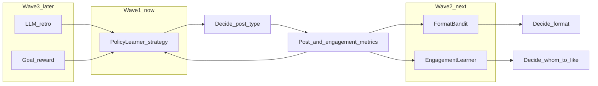
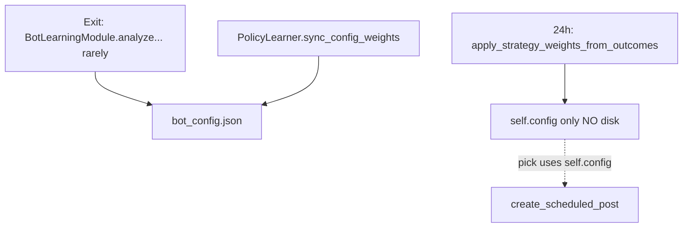
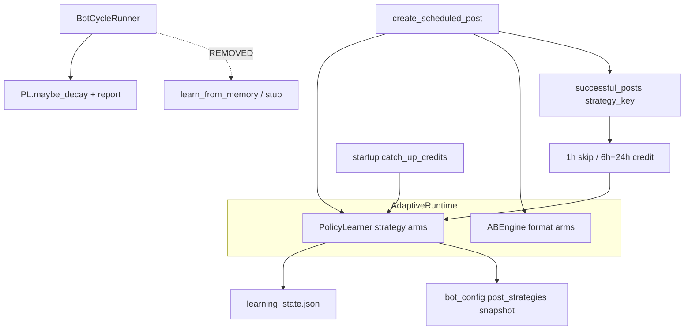
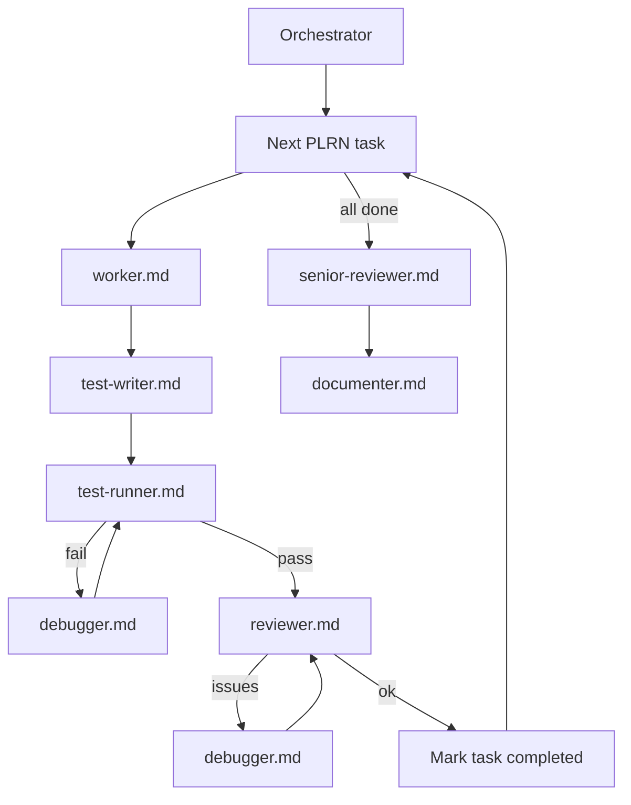
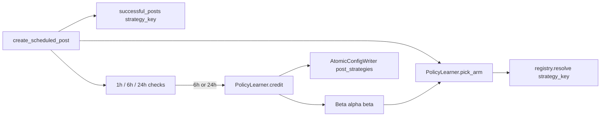

# PolicyLearner: full learning subsystem rewrite

## North star (простыми словами)

Цель пользователя: бот **сам учится и сам принимает решения** — почти как самостоятельный AI-агент.

Агент = цикл:

```text
наблюдает метрики → обновляет «память/веса» → сам выбирает действие → снова смотрит результат
```

Решения бота разбиты на **домены** (каждый со своим обучаемым «мозгом»):

| Домен | Вопрос | Сейчас | В этом плане |
|---|---|---|---|
| **A. Стратегия поста** | Какой тип поста писать? | stub / хаос | **Wave 1 — IN SCOPE** PolicyLearner |
| **B. Формат текста** | A/B буллеты или абзац? | ABEngine ε-greedy | **Wave 2 — IN SCOPE** FormatBandit |
| **C. Engagement** | Какие темы лайкать сильнее? | static thresholds | **Wave 2 — IN SCOPE** EngagementLearner |
| **D. Рефлексия** | LLM переписывает правила | нет | Wave 3 — backlog |
| **E. Цель** | reward = followers | неявно | Wave 3 — backlog |

**Решение пользователя: B** — Wave 1+2 **одним большим заходом** (PLRN-000…012). Wave 3 не кодится сейчас.


## Review note (completeness)

**Execution scope = Wave 1 + Wave 2.** Один orchestration workspace; tasks строго по ID (не смешивать FormatBandit и Strategy в одном worker). Shared bandit math живёт в `policy_learner.py` (переиспользуется).---

## Deep inventory (as-is) — обязательно знать агентам

### Файлы

| Файл | Роль сегодня |
|---|---|
| [`app/bot_learning_module.py`](app/bot_learning_module.py) | Stub SEAL: likes часто 0; устаревший type→strategy; **вызывается только при выходе** из `run_bot_cycle` (~2366), не каждый тик |
| [`app/strategy_learning.py`](app/strategy_learning.py) | LEARN-001: мутирует `config['post_strategies']` по `topic_outcomes`; **на диск не пишет** |
| [`app/growth_engine.py`](app/growth_engine.py) `ABEngine` | Отдельный learner для `format_a/b` (ε=0.2 после 10 impressions) |
| [`app/bot_cycle.py`](app/bot_cycle.py) | Каждые 10 тиков: `update_posts_with_real_metrics` + `learn_from_memory` |
| [`app/bluesky_bot_v2.py`](app/bluesky_bot_v2.py) | Composition root: publish, delayed checks, topic boost, stub exit learn |
| [`app/content_service.py`](app/content_service.py) | `schedule_post_performance_checks` → 1h/6h/24h asyncio tasks |
| [`packaging/sync-opt-from-sot.sh`](packaging/sync-opt-from-sot.sh) | SoT→opt; сейчас `bot_learning_module.py` + `strategy_learning.py`, **нет** `policy_learner.py` |

### Память (`BotMemory` / `bot_memory.json`)

| Поле | Пишется | Читается для решений |
|---|---|---|
| `successful_posts` | publish + **comments** (type=comment, без uri) | trend texts, metrics, LEARN-001 keys via `type` |
| `ab_results` | ABEngine record_* | `pick_format` |
| `topic_outcomes` | delayed_performance_check | ×1.3 boost стратегий + LEARN-001 weights |
| `content_performance` | `learn_from_memory` | **нигде не читается** (dead write) |
| `interaction_patterns` | `learn_from_memory` | dead / logging only |
| `source_outcomes`, `pattern_blacklist`, `engagement_metrics` | schema only | effectively unused for learning |
| `viral_posts` | append high viral_score | reporting / memory trim |

### Три писателя весов `post_strategies` (конфликт)



### Критические баги as-is (план обязан закрыть)

1. Stub почти мёртв (exit-only); реальный LEARN-001 **не персистит** веса.
2. Нет `strategy_key` на постах → обучение по `type` + fuzzy match.
3. `successful_posts` засорены комментариями без uri.
4. Delayed credit **теряется при restart** (tasks cancel в `shutdown` / crash).
5. `engagement_rate` = сумма likes+reposts+replies (не rate) — OK как score input, но не путать с ER%.
6. Dual policy: Thompson/weights **и** topic_outcomes ×1.3 boost одновременно.

### Целевая архитектура (to-be)



Единый фасад: **только PolicyLearner** меняет strategy weights. ABEngine остаётся для формата. `topic_outcomes` — **только telemetry** (или soft hint ≤1.05, не ×1.3). `learn_from_memory` / stub / LEARN-001 apply — **удалить**.
---

## Orchestration (как `.cursor/agents`)

### Режим запуска

1. Создать workspace: `.cursor/workspace/active/orch-policy-learner/` (`progress.json`, `tasks.json`, `links.json` → этот plan file).
2. Скопировать/связать план также в `ai_docs/develop/plans/2026-10-19-policy-learner-bandit.md` (paths из [`.cursor/config.json`](.cursor/config.json)).
3. Для **каждого** `PLRN-00x` запускать **отдельный цикл агентов** (не один агент на весь план):



### Общий контекст-пакет (вкладывать в КАЖДЫЙ вызов агента)

Каждый субагент получает **полный** prompt, не «продолжи предыдущее»:

```text
## Role
Follow .cursor/agents/{worker|test-writer|test-runner|reviewer|debugger|...}.md exactly.
First read listed skills.

## Skills (mandatory)
- .cursor/skills/code-quality-standards/SKILL.md
- .cursor/skills/architecture-principles/SKILL.md  (for PLRN-002+)
- .cursor/skills/task-management/SKILL.md          (orchestrator only)

## Plan SoT
- .cursor/plans/policylearner_bandit_upgrade_d78a9f5f.plan.md
  (sections: Decisions, Phase A–D formulas, dual-credit, learning_state schema, Public API)

## Repo conventions
- App SoT: app/  (not root duplicates unless packaging)
- Hermetic tests under tests/; no live Bluesky/OpenRouter in unit tests
- Do not import bluesky_bot_v2 from policy_learner.py
- Conventional commits if committing (only if user asked)

## This task only
{TASK_ID}: {title}
Dependencies: {deps} must be completed
Files to touch: {files}
Acceptance criteria: {checklist}
Out of scope: composite arms, ABEngine→bandit, 1h credit, LLM retro, engagement-action learning

## Done means
- Code matches acceptance criteria
- Tests added/updated and mentioned in summary
- Short summary: files changed, how to verify
```

### Правила изоляции агентов

- **Один task ID = один worker-проход** (не смешивать Phase B и C в одном агенте).
- Worker **не** пишет markdown-доки (`ai_docs/`) — это documenter в конце.
- Test-writer пишет hermetic tests; test-runner гоняет pytest + lints.
- Debugger только после fail test-runner/reviewer (max 3 retry).
- Senior-reviewer один раз в конце (архитектура PolicyLearner vs stub removal).
- Documenter: `ai_docs/develop/reports/2026-10-19-policy-learner.md` + changelog note.

### Карта task → агенты (Wave 1+2)

| Task | Primary | Depends |
|---|---|---|
| PLRN-000 | orchestrator | — |
| PLRN-001 | worker→TW→TR→rev | 000 |
| PLRN-002 | worker→TW→TR→rev | 001 |
| PLRN-003 ∥ PLRN-004 | worker cycles | 002 |
| PLRN-005 | worker→TW→TR→rev | 001–004 |
| PLRN-007 | worker→TW→TR→rev | 005 |
| PLRN-010 | worker→TW→TR→rev | 007 (нужен shared core + post credit path) |
| PLRN-011 | worker→TW→TR→rev | 007 |
| PLRN-012 | worker→TW→TR→rev | 010, 011 (логирует оба) |
| PLRN-008 | worker→TR→rev | 012 |
| PLRN-006 | senior-reviewer→documenter | 008 |

PLRN-010 ∥ PLRN-011 после 007; затем 012 → 008 → 006.
## Decisions (fixed) — полная переработка

- **Wave 1 arms = `strategy_key`** (~6 registry names).
- **Wave 2 format arms = `format_a`/`format_b`** (FormatBandit заменяет `ABEngine.pick_format`; suffixes остаются).
- **Wave 2 engagement arms = topic_groups + `_other`** (множители score, не per-DID).
- **Runtime pick = Thompson ONE arm** per domain; config snapshots после credit.
- **Reward**: 6h+24h fractional credit (0.35/0.65); 1h metrics only.
- **State**: `learning_state.json`; memory держит post fields + `ab_results` + `topic_outcomes` (telemetry).
- **Единственный writer strategy weights**: `PolicyLearner.sync_config_weights`. Удалить:
  - `BotLearningModule.analyze_performance_and_learn` (+ вызов на exit)
  - `apply_strategy_weights_from_outcomes` / `_update_strategy_weights_from_memory`
  - `learn_from_memory` из bot_cycle tick (или no-op stub удалить)
- **`topic_outcomes` ×1.3 boost — УБРАТЬ** из `create_scheduled_post` (иначе dual policy). Оставить накопление outcomes для report/telemetry only.
- **`content_performance` / frequency learn_from_memory — УБРАТЬ** запись (dead).
- **Eligible posts for credit**: `uri` present AND `strategy_key` present AND `type != 'comment'` AND metrics from API.
- **Novelty idle_days**: считать по `max(last_credit_at, last_pick_at)` на arm (хранить `last_pick_at` в learning_state при pick).
- **После sync_config**: `self.config['post_strategies'] = learner.export_weights()` (reload in-memory).
- **Arm migration**: при load — add missing keys from config (warm-start); retire arms absent from config (keep in state under `retired` or drop if trials==0).
- **Restart catch-up**: на startup после load memory — для постов age∈[6h,36h] без нужного `rewarded_checks` вызвать sync credit (reuse `analyze_post_performance`), не полагаться только на asyncio sleep tasks.


## Current gaps to close

- На посте есть `type` + `ab_format`, **нет** `strategy_key` — [`app/bluesky_bot_v2.py`](app/bluesky_bot_v2.py) (~1426–1442).
- Stub [`app/bot_learning_module.py`](app/bot_learning_module.py) + вызов конца цикла (~2368).
- Метрики уже в `delayed_performance_check` (~2523–2564); 24h → `_update_strategy_weights_from_memory`.
- В [`bot_config.json`](bot_config.json) нет `learning_parameters`.
- `registry.weighted_entries` возвращает callables без имени — нужен `weighted_named_entries` или pick → `resolve(name)`.

---

## Phase A — данные (подробно)

1. В `create_scheduled_post`:
   - `strategy_key = self.policy_learner.pick_arm(list(post_strategies.keys()), recent_posts=...)`
   - `self._current_strategy_key = strategy_key`
   - `post = await self.post_strategy_registry.resolve(strategy_key)()`
   - Quality regen: снова `pick_arm` (или тот же key — зафиксировать: **re-pick** при regen).
2. В `post_data` обязательно:
   ```python
   {
     "strategy_key": strategy_key,       # e.g. "_create_quality_news_post"
     "ab_format": ab_format,             # unchanged, for ABEngine only
     "type": content_type,               # unchanged
     "rewarded_checks": [],              # e.g. ["6h"], ["6h","24h"]
     "likes": None, "reposts": None, "replies": None,  # set only after metrics fetch
   }
   ```
3. Credit разрешён только если `likes/reposts/replies` пришли из API (`final_stats` / analyze), не default `0` до первого check.
4. Старый type→strategy map из stub **запрещён** для обучения.
5. Посты без `strategy_key` (legacy) — skip credit, лог debug.
6. Не класть comments в `successful_posts` (PLRN-007); до фикса — credit filter `type != 'comment'`.
7. Helper `recent_strategy_keys_24h(posts)` для share cap.
---

## Phase B — ядро (vibe-x formulas, exact)

### Reference mapping (vibe-x → наш бот)

| vibe-x | Ours |
|---|---|
| content **angle** arm | `strategy_key` |
| Select: sample Beta → argmax (+ ε floor) | `pick_arm()` + `weight_min` / ε |
| Settle after `REWARD_SETTLE_DAYS` | 6h + 24h delayed checks |
| `α += r; β += (1-r)` | same, but **scaled** by check weight |
| single JSON state | `learning_state.json` |

### Reward (adapted vibe-x; Bluesky has no quotes/bookmarks in our metrics)

```text
score  = 1*likes + 2*replies + 3*reposts
r      = 1 - exp(-score / reward_scale)    # in [0, 1)
# defaults: reward_scale = 10
```

### Dual-credit (6h + 24h) — not two full trials

vibe-x = 1 settle / post. Мы хотим early + mature signal без double-counting:

```text
check_id "6h":  w = 0.35
check_id "24h": w = 0.65
# credit once per (uri, check_id) via rewarded_checks

alpha += w * r
beta  += w * (1 - r)
trials += w          # fractional trials OK for reporting
```

Idempotency: if `check_id in post["rewarded_checks"]` → no-op. Append after successful credit.

### Thompson pick (vibe-x Select)

```text
for each arm in enabled_keys:
  sample_i ~ Beta(alpha_i, beta_i)
  if idle_days(arm) >= novelty_idle_days:
    sample_i += novelty_bonus          # xbot-style exploration nudge
  if share_24h(arm) > max_arm_share_24h:
    skip arm                           # diversity quota
pick = argmax(sample_i)

# ε-floor (vibe-x "nothing starves"):
with probability epsilon (default 0.10):
  pick = uniform among arms not blocked by share cap
```

After pick, **do not** convert all samples to softmax weights for this post. Optionally sync `export_weights()` to config for humans:

```text
mean_i = alpha_i / (alpha_i + beta_i)
weight_i = max(weight_min, mean_i)
normalize so sum(weights) == 1
```

While `total_credit_mass < min_settled_posts`: `export_weights()` returns **bootstrap** weights (from config / warm-start), pick_arm still may explore via ε but **must not** rewrite config.

### Soft decay (emolt-style, every N cycles)

```text
# prior = Beta(1,1) or warm-start prior_alpha/prior_beta stored at init
alpha = (1 - decay_rate) * alpha + decay_rate * prior_alpha
beta  = (1 - decay_rate) * beta  + decay_rate * prior_beta
# decay_rate default 0.005; every decay_every_cycles (default 20) bot cycles
```

### Warm-start

On first load, for each config key with weight `w`:

```text
# concentrate prior proportional to config weight; strength S=4
alpha = 1 + S * w
beta  = 1 + S * (1 - w)
```

### `learning_state.json` schema

```json
{
  "version": 1,
  "cycle_count": 0,
  "total_credit_mass": 0.0,
  "arms": {
    "_create_quality_news_post": {
      "alpha": 1.0, "beta": 1.0,
      "prior_alpha": 1.0, "prior_beta": 1.0,
      "trials": 0.0,
      "last_reward": null,
      "last_credit_at": null,
      "last_pick_at": null
    }
  },
  "retired_arms": {},
  "deltas": [
    {"ts": "...", "arm": "...", "check": "6h", "r": 0.42, "w": 0.35, "alpha": 1.2, "beta": 1.1}
  ],
  "bootstrap_weights": { "...": 0.3 }
}
```

`deltas`: ring buffer max 20. Novelty uses `max(last_credit_at, last_pick_at)`.

### Public API (`app/policy_learner.py`)

```python
class PolicyLearner:
    def __init__(self, path, params: dict, arm_keys: list[str], bootstrap_weights: dict)
    @classmethod
    def load(...) -> PolicyLearner
    def save(self) -> None
    def pick_arm(self, keys, recent_strategy_keys_24h: list[str]) -> str
    def record_pick(self, strategy_key: str) -> None
    def credit(self, strategy_key, likes, reposts, replies, check_id: str) -> bool
    def maybe_decay(self) -> None
    def export_weights(self) -> dict[str, float]
    def sync_arms_with_config(self, arm_keys: list[str], bootstrap: dict) -> None
    def report(self) -> dict
    def sync_config_weights(self, config_path) -> None  # bak + AtomicConfigWriter
```

Catch-up orchestration lives on the bot (async metrics fetch) calling `credit` + updating `rewarded_checks` on posts. No import of `bluesky_bot_v2`.
### Integration table (полная)

| Место | Действие |
|---|---|
| bot `__init__` | `PolicyLearner.load`; **remove** `BotLearningModule`; затем `await/catch_up_pending_credits()` (or sync helper) |
| `create_scheduled_post` | remove topic ×1.3 boost; `pick_arm` → `resolve`; set `last_pick_at`; persist `strategy_key` |
| `delayed_performance_check` | 1h: metrics only; 6h/24h: metrics + credit + sync + refresh `self.config`; remove LEARN-001 apply |
| `BotCycleRunner` / ports | replace `learn_from_memory` with `policy_learner_tick` = `maybe_decay` + optional `report` log (every 10 or every cycle end in runner — prefer **every tick end via bot after tick**, or every 10 cycles) |
| `run_bot_cycle` exit block | **delete** analyze_performance_and_learn entirely |
| `comment` append to successful_posts | stop appending comments into `successful_posts` OR tag `exclude_from_learning: true` (prefer **stop** / separate list) |
| `update_posts_with_real_metrics` | keep as metrics refresh; must not credit without check_id rules; may set likes fields for catch-up |

### Public API additions (hardening)

```python
def record_pick(self, strategy_key: str) -> None: ...
def sync_arms_with_config(self, arm_keys: list[str], bootstrap: dict) -> None: ...
def catch_up_from_posts(self, posts: list[dict], fetch_metrics) -> int: ...
# fetch_metrics async injected by bot; learner stays sync-core + bot orchestrates await
```

[`app/bot_learning_module.py`](app/bot_learning_module.py): delete after PLRN-005/007 (or leave empty shim exporting nothing). [`app/strategy_learning.py`](app/strategy_learning.py): delete apply_* ; keep `WEIGHT_MIN` constants moved into `policy_learner.py` OR thin re-export for old tests then update tests.
---

## Phase C — anti-convergence from xbot (урезанный набор)

Берём из xbot **только 3 слоя** (не continuous 7d re-score, не contrarian every-5-posts в v1):

1. **Diversity quota** (`max_arm_share_24h=0.40`): среди `successful_posts` за 24h с `strategy_key`, доля одного arm ≤ 40%, иначе arm excluded from pick.
2. **Novelty** (`novelty_idle_days=14`, `novelty_bonus=0.15`): если arm не credit'ился / не выбирался >14 дней → `sample += novelty_bonus` before argmax.
3. **Cold-start freeze** (`min_settled_posts=5`): пока `total_credit_mass < 5` — не `sync_config_weights`; export = bootstrap.

Не в v1 (явно out): xbot time-decay drop scores >60d как отдельный store; decline detection −20%; forced contrarian every 5 posts (можно backlog).

### `learning_parameters` (полный блок в bot_config.json)

```json
"learning_parameters": {
  "reward_scale": 10,
  "credit_weight_6h": 0.35,
  "credit_weight_24h": 0.65,
  "min_settled_posts": 5,
  "max_arm_share_24h": 0.40,
  "novelty_idle_days": 14,
  "novelty_bonus": 0.15,
  "epsilon": 0.10,
  "decay_every_cycles": 20,
  "decay_rate": 0.005,
  "weight_min": 0.05,
  "warm_start_strength": 4,
  "deltas_max": 20,
  "state_path": "learning_state.json"
}
```

---

## Phase D — observability

- `report()` fields: per-arm `{alpha, beta, mean, trials, last_reward}`, `total_credit_mass`, `last_20_deltas`, `export_weights`.
- Log INFO once per cycle (compact one-liner + optional JSON file `reports/learning_report.json`).
- `sync_config_weights`: copy `bot_config.json` → `bot_config.json.bak` then `AtomicConfigWriter.save`.
- Packaging: copy `policy_learner.py` into `opt/bluesky-bot/`; ensure state file lives under WorkingDirectory `/opt/bluesky-bot` on server.

---

## Tests

- [`tests/test_policy_learner.py`](tests/test_policy_learner.py):
  - `compute_reward(0,0,0)==0`, monotonic in likes
  - credit 6h then 24h → α/β increase by w*r; second same check_id no-op (caller responsibility) / learner ignores duplicate if passed flag
  - pick_arm respects share cap and ε
  - novelty boost changes pick distribution under controlled RNG
  - freeze export until min_settled
  - decay moves α/β toward prior
  - AST: no `bluesky_bot_v2` import
- Adjust [`tests/test_strategy_learning_learn001.py`](tests/test_strategy_learning_learn001.py): keep WEIGHT_MIN helper tests or mark module deprecated.
- Small unit: helper that builds `post_data` includes `strategy_key` + `rewarded_checks`.

## Agent briefs (полный контекст на задачу)

Каждый блок ниже — **готовый prompt** для запуска отдельного agent-цикла. Orchestrator копирует блок + «Общий контекст-пакет» выше.

---

### PLRN-000 — Bootstrap orchestration

- **Agent:** planner / orchestrator (human-driven ok)
- **Do:**
  - Create `.cursor/workspace/active/orch-policy-learner/{progress,tasks,links}.json`
  - `links.plan` → `.cursor/plans/policylearner_bandit_upgrade_d78a9f5f.plan.md`
  - Mirror plan to `ai_docs/develop/plans/2026-10-19-policy-learner-bandit.md`
  - Init all PLRN tasks as `pending` in `tasks.json`
- **Acceptance:** workspace exists; tasks.json lists PLRN-001…006; plan linked
- **No code changes**

---

### PLRN-001 — Phase A data + pick wiring

- **Agents:** worker → test-writer → test-runner → reviewer
- **Skills:** code-quality-standards, architecture-principles
- **Read first:**
  - Plan sections: Decisions, Phase A
  - [`app/bluesky_bot_v2.py`](app/bluesky_bot_v2.py) `create_scheduled_post` (~1305–1460)
  - [`app/post_strategies.py`](app/post_strategies.py) `resolve` / `weighted_entries`
- **Implement:**
  1. Persist `self._current_strategy_key` before strategy call
  2. Add to `post_data`: `strategy_key`, `rewarded_checks: []`; likes/reposts/replies start as `None`
  3. Temporary pick: if PolicyLearner absent, pick by existing weighted_entries **but still record the config key name** (extend registry to return `(name, fn)` or resolve after named pick)
  4. Quality regen: re-pick or keep key — **use re-pick** per plan
- **Do NOT yet:** full Thompson, credit, config rewrite
- **Files:** `app/bluesky_bot_v2.py`, maybe `app/post_strategies.py`, tests
- **Acceptance:**
  - [ ] New successful_posts entries include `strategy_key` matching registry name
  - [ ] `rewarded_checks` is `[]` on create
  - [ ] Hermetic test asserts post_data shape (no live API)
  - [ ] Existing publish path still runs

**Worker prompt addendum:**
```text
TASK_ID=PLRN-001
Deps=PLRN-000
Files=app/bluesky_bot_v2.py, app/post_strategies.py, tests/test_policy_learner_data_plrn001.py
Goal=Wire strategy_key persistence only; stub pick OK.
```

---

### PLRN-002 — Phase B PolicyLearner core

- **Agents:** worker → test-writer → test-runner → reviewer
- **Skills:** code-quality-standards, architecture-principles
- **Read first:** Plan Phase B (reward, dual-credit, Thompson, decay, schema, Public API); vibe-x credit semantics in plan table
- **Implement:** new [`app/policy_learner.py`](app/policy_learner.py) only (no bot wiring yet beyond optional import-safe stubs)
  - `compute_reward`, `pick_arm`, `credit`, `maybe_decay`, `export_weights`, `load`/`save`, `report`
  - Dual-credit weights 0.35/0.65
  - Warm-start from bootstrap weights
  - Ring buffer deltas max 20
  - **No** `bluesky_bot_v2` import
- **Files:** `app/policy_learner.py`, `tests/test_policy_learner.py`
- **Acceptance:**
  - [ ] Unit tests cover reward, dual-credit math, freeze export, decay, ε/share hooks (share can accept injected recent list)
  - [ ] AST test: no bot import
  - [ ] `learning_state.json` round-trip load/save in tmpdir

**Worker prompt addendum:**
```text
TASK_ID=PLRN-002
Deps=PLRN-001
Files=app/policy_learner.py, tests/test_policy_learner.py
Goal=Pure PolicyLearner module matching plan Public API + formulas.
```

---

### PLRN-003 — Phase C anti-convergence + config

- **Agents:** worker → test-writer → test-runner → reviewer
- **Parallel OK with PLRN-004 after PLRN-002**
- **Read first:** Plan Phase C; xbot layers listed (diversity / novelty / freeze only)
- **Implement:**
  - Add full `learning_parameters` block to [`bot_config.json`](bot_config.json) (+ `opt/` + `etc/` copies if project keeps them in sync)
  - Enforce in `PolicyLearner.pick_arm` / `export_weights`: max_arm_share_24h, novelty, min_settled freeze
  - Tests for blocked arm + novelty boost under fixed RNG seed
- **Acceptance:**
  - [ ] Config keys match plan JSON exactly
  - [ ] Share cap excludes arm when recent list is 100% one key
  - [ ] export_weights frozen until total_credit_mass >= min_settled_posts

**Worker prompt addendum:**
```text
TASK_ID=PLRN-003
Deps=PLRN-002
Files=bot_config.json, opt/bluesky-bot/bot_config.json, etc/bluesky-bot/bot_config.json, app/policy_learner.py, tests/test_policy_learner.py
Goal=Anti-convergence gates + learning_parameters.
```

---

### PLRN-004 — Phase D observability + packaging

- **Agents:** worker → test-writer → test-runner → reviewer
- **Parallel OK with PLRN-003**
- **Implement:**
  - `report()` → log-friendly dict; write `reports/learning_report.json` helper (path configurable)
  - `sync_config_weights`: `.bak` then `AtomicConfigWriter` ([`app/state_service.py`](app/state_service.py))
  - Packaging: ensure `policy_learner.py` listed/copied under `opt/bluesky-bot/` per existing packaging pattern
- **Acceptance:**
  - [ ] report contains alpha/beta/mean/trials/deltas
  - [ ] bak created before config overwrite in unit test with tmp paths
  - [ ] opt/ package includes module

**Worker prompt addendum:**
```text
TASK_ID=PLRN-004
Deps=PLRN-002
Files=app/policy_learner.py, opt/bluesky-bot/policy_learner.py, tests/test_policy_learner.py
Goal=Observability + atomic config sync + packaging.
```

---

### PLRN-005 — Wire into bot; remove stub + LEARN-001 apply

- **Agents:** worker → test-writer → test-runner → reviewer
- **Read first:** Inventory + Integration table; `delayed_performance_check`; `run_bot_cycle` exit; `BotCycleRunner.tick` learn_from_memory; topic boost block (~1335)
- **Implement:**
  1. Init `PolicyLearner.load` + `sync_arms_with_config`
  2. Publish: `pick_arm` → `record_pick` → `resolve`; remove ×1.3 topic boost
  3. Delayed: 1h metrics-only; 6h/24h credit + `rewarded_checks` + sync + refresh `self.config`
  4. Delete exit `analyze_performance_and_learn`; delete `_update_strategy_weights_from_memory` call
  5. Bot cycle: replace `learn_from_memory` port with `policy_learner_on_tick` (maybe_decay every 10 cycles + report log)
  6. Delete/empty `bot_learning_module.py` learning; stop importing BotLearningModule
- **Acceptance:**
  - [ ] Grep: no `analyze_performance_and_learn`, no `apply_strategy_weights_from_outcomes` call sites in app/
  - [ ] Grep: no topic boost `1.3` in create_scheduled_post
  - [ ] 6h/24h credit idempotent via rewarded_checks
  - [ ] In-memory `self.config['post_strategies']` matches export after sync

**Worker prompt addendum:**
```text
TASK_ID=PLRN-005
Deps=PLRN-001..004
Files=app/bluesky_bot_v2.py, app/bot_cycle.py, app/bot_learning_module.py, tests/
Goal=Wire PolicyLearner; remove all dual strategy-weight writers + topic boost.
```

---

### PLRN-007 — Hardening (полная переработка gap-close)

- **Agents:** worker → test-writer → test-runner → reviewer
- **Read first:** Decisions hardening bullets; Inventory bugs 1–6
- **Implement:**
  1. **Catch-up on startup:** scan `successful_posts` with uri+strategy_key; if age≥6h and `"6h"∉rewarded_checks` (and <36h) fetch metrics + credit; same for 24h; save memory
  2. **Comments:** stop appending comments into `successful_posts` (or `exclude_from_learning`); credit eligibility filter
  3. **Arm migration** `sync_arms_with_config` on every config load / init
  4. **Delete** dead `learn_from_memory` body / content_performance writes; update `CallableBotCyclePorts` if signature changes
  5. **strategy_learning.py**: remove apply_*; migrate tests to PolicyLearner; keep or delete module
  6. Document `idle_days` = max(last_pick_at, last_credit_at)
- **Acceptance:**
  - [ ] Unit: catch-up credits missing 6h for 7h-old post (mocked fetch)
  - [ ] Unit: comment-type post never credited
  - [ ] Unit: new config arm appears in state after sync_arms
  - [ ] No dual writers remain (grep)

**Worker prompt addendum:**
```text
TASK_ID=PLRN-007
Deps=PLRN-005
Files=app/policy_learner.py, app/bluesky_bot_v2.py, app/bot_cycle.py, app/strategy_learning.py, tests/
Goal=Restart catch-up, migration, remove dead learners, exclude noise posts.
```

---

### PLRN-008 — Packaging, smoke, deploy checklist

- **Agents:** worker → test-runner → reviewer
- **Deps:** PLRN-012 (весь Wave 1+2 код на месте)
- **Implement:**
  1. PYFILES: `policy_learner.py`, `engagement_learner.py` (если отдельный), `agent_decision_log.py`; remove `bot_learning_module.py` if deleted
  2. sync-opt-from-sot + bot_config knobs (`learning_parameters`, `format_learning`, `engagement_learning`)
  3. smoke: load three bandit states tmpdir + one pick/credit each
  4. Deploy checklist: writable `learning_state_*.json`, restart, journal domains
- **Acceptance:** sync lists all modules; smoke green; checklist in docs

---

### PLRN-006 — Final review + docs (Wave 1+2)

- **Agents:** senior-reviewer → documenter
- **Depends:** PLRN-008
- **senior-reviewer checklist:**
  - [ ] Single writer for strategy weights; FormatBandit owns format pick
  - [ ] Engagement multipliers only via EngagementLearner (no ×1.3 topic boost)
  - [ ] Three state files isolated; catch-up both domains
  - [ ] DecisionLog present; no secrets
  - [ ] Isolation: bandit modules no bot import
- **documenter:** report `ai_docs/develop/reports/2026-10-19-autonomous-learning-agent.md` — три домена решений, knobs, ops; ADR; CHANGELOG

---

## Definition of Done (полная переработка Wave 1 — см. также DoD Wave 1+2 ниже)

- [ ] Stub BotLearningModule gone from runtime
- [ ] LEARN-001 apply_strategy_weights gone from runtime
- [ ] learn_from_memory frequency weights gone
- [ ] topic ×1.3 boost gone
- [ ] PolicyLearner picks strategies; credits 6h/24h; persists learning_state + config snapshot
- [ ] Startup catch-up restores missed credits after reboot
- [ ] (Wave 2) FormatBandit + EngagementLearner + DecisionLog — см. DoD Wave 1+2
- [ ] Packaging + smoke green
- [ ] Docs + senior review done

## Wave 2 — детальная спецификация (IN SCOPE этого захода)

### Shared core

Переиспользовать [`app/policy_learner.py`](app/policy_learner.py) как generic `ThompsonBandit` (или фабрика `PolicyLearner.for_domain(name, arms, state_path)`):

- `learning_state_strategy.json` — домен A  
- `learning_state_format.json` — домен B (`format_a`, `format_b`)  
- `learning_state_engagement.json` — домен C (topic arms)

Одинаковые: reward formula, dual-credit weights, decay, novelty, share cap, ε.

### PLRN-010 — FormatBandit

**Замена:** `ABEngine.pick_format` → `format_bandit.pick_arm(["format_a","format_b"])`.

**Сохранить:** `AB_FORMATS` prompt suffixes в `growth_engine.py`; `get_prompt_suffix` без изменений.

**Credit:** в `delayed_performance_check` при 6h/24h — кроме strategy credit, `format_bandit.credit(ab_format, likes, reposts, replies, check_id)` используя те же метрики своего поста. Idempotency: `rewarded_checks_format` на post **или** общий `rewarded_checks` с ключами `"6h:format"` / хранить в bandit state по `(uri, check)` — проще: на post поле `format_rewarded_checks: []`.

**Deprecate:** накопление `ab_results` ER для pick (можно оставить record для report telemetry). `pick_format` становится thin wrapper над FormatBandit.

**Anti-convergence:** max_arm_share_24h для 2 arms → default **0.70** (иначе при 40% с 2 arms почти всегда блок). Отдельный knobs в config:

```json
"format_learning": {
  "enabled": true,
  "max_arm_share_24h": 0.70,
  "epsilon": 0.15,
  "state_path": "learning_state_format.json"
}
```

### PLRN-011 — EngagementLearner

**Arms:** ключи `relevance_settings.topic_groups` + `_other` (ai, tech, policy, …).

**Решение (не «кого» по DID, а «какие темы усиливать»):**  
перед сравнением с `like_threshold` / repost threshold:

```text
topic = infer_topic(text)  # existing keyword groups
mult  = 0.5 + export_mean(topic)   # mean in [0,1] → mult in [0.5, 1.5]
effective_score = relevance_score * mult
# like if effective_score >= like_threshold
```

**Запись действия:** при like/repost в ledger/memory:

```python
{"kind": "like"|"repost", "topic": "ai", "uri": "...", "ts": "...", "rewarded_checks": []}
```

Хранить в `bot_memory.engagement_actions` (новый list, trim 500) или jsonl `engagement_actions.jsonl`.

**Reward (прокси «вкус»):** через 6h/24h fetch metrics **того чужого поста**, который лайкнули:

```text
score = likes + 2*replies + 3*reposts   # их пост
r = 1 - exp(-score / reward_scale)
credit topic arm
```

Смысл: бот учится чаще лайкать темы, где посты потом набирают engagement (алгоритм/аудитория совпадают).

**Catch-up:** как strategy — на startup для actions без checks.

**Wire:** [`app/smart_engagement.py`](app/smart_engagement.py) через port `topic_multiplier(topic) -> float`; composition root передаёт EngagementLearner.

**Config:**

```json
"engagement_learning": {
  "enabled": true,
  "max_arm_share_24h": 0.40,
  "epsilon": 0.10,
  "state_path": "learning_state_engagement.json",
  "action_credit_delays_hours": [6, 24]
}
```

### PLRN-012 — AgentDecisionLog

Файл append-only `reports/agent_decisions.jsonl` (или `var`-style рядом с cwd):

```json
{"ts":"...","domain":"strategy|format|engagement","action":"...","arm":"...","reason":"thompson|epsilon|share_cap","context":{}}
```

Писать при каждом `pick_arm` / like-decision с multiplier. Не секреты. Ротация: max 10k lines / 30 days.

`report()` агрегаторов ссылается на last N decisions.

---

## Agent briefs — Wave 2

### PLRN-010 — FormatBandit

```text
TASK_ID=PLRN-010
Deps=PLRN-007
Files=app/policy_learner.py (reuse), app/growth_engine.py, app/bluesky_bot_v2.py, bot_config.json, tests/test_format_bandit.py
Goal=Replace ABEngine.pick_format with Thompson FormatBandit; credit on 6h/24h own-post metrics; keep prompt suffixes.
Acceptance:
- [ ] pick_format delegates to bandit
- [ ] format_a/b both get credits
- [ ] share cap 0.70 for 2 arms
- [ ] hermetic tests; no bluesky_bot_v2 import in bandit module
```

### PLRN-011 — EngagementLearner

```text
TASK_ID=PLRN-011
Deps=PLRN-007
Files=app/engagement_learner.py (or policy_learner domain), app/smart_engagement.py, app/bluesky_bot_v2.py, bot_config.json, tests/test_engagement_learner.py
Goal=Topic-arm Thompson multipliers on relevance score; delayed credit on liked post metrics; catch-up.
Acceptance:
- [ ] like uses effective_score = score * mult(topic)
- [ ] actions persisted; 6h/24h credit updates topic arms
- [ ] startup catch-up for engagement actions
- [ ] hermetic tests with fake posts/scores
```

### PLRN-012 — DecisionLog

```text
TASK_ID=PLRN-012
Deps=PLRN-010,PLRN-011
Files=app/agent_decision_log.py, wire in pick/credit paths, tests/test_agent_decision_log.py
Goal=Append-only decision log for strategy/format/engagement picks.
Acceptance:
- [ ] jsonl lines for each domain pick
- [ ] rotation/trim safe
- [ ] no PII/secrets
```

---

## Definition of Done (Wave 1+2)

- [ ] Все DoD Wave 1 (stub gone, strategy bandit, catch-up, …)
- [ ] Format выбирается FormatBandit; ABEngine pick deprecated
- [ ] Engagement множит score по topic arms и учится на метриках лайкнутых постов
- [ ] DecisionLog пишется
- [ ] packaging/smoke включают новые модули
- [ ] Docs описывают три домена решений агента

## Wave 3 — backlog (не в этом заходе)

- PLRN-020 followers-delta reward  
- PLRN-021 LLM-retro weekly  
- PLRN-022 extra safety governor beyond existing budget/limits  

## Out of scope (даже в Wave 1+2)

- Per-DID «лайкать Ивана» (только topic arms)  
- 1h bandit credit  
- Migrating posts without strategy_key  
- Один worker на весь план  
